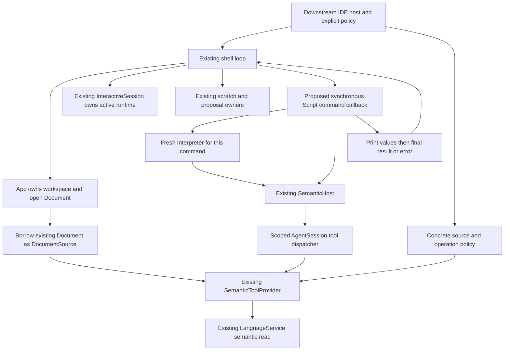

# E8 — Interactive Scope Script Workbench Discovery

## Decision and scope

**Recommend one explicit command in the existing IDE shell, backed by a downstream, host-supplied callback that synchronously borrows the current document.** Run the existing `workspace_semantic.scope` with a fresh interpreter, the existing selection-description provider, and `SemanticHost`; present retained output followed by the final value or typed error, then return to the same shell.

This is a design, not an implemented command. No production behavior is changed by E8. Existing evaluator and semantic-dispatch APIs suffice; the missing pieces are a shell invocation hook, explicit selection input, and presentation/error containment at that hook. There is no existing command that connects all of these pieces.

The first experiment should use the ordinary shell, not the separate TUI. It must not select Script as the active document language or replace the active interactive runtime. `AgentSession` below is the existing deterministic tool dispatcher; constructing it does **not** imply agent planning, model calls, or agent execution.

## 1. Current architecture and relevant public interfaces

Paths below are repository-relative. Line references describe the inspected revision.

### Interactive IDE

| Interface / owner | Existing behavior and relevance |
| --- | --- |
| `cli::run_with_registry`, `cli::run_with_session` | Register services/providers or transfer an existing `App` and `InteractiveSession` into the shell. `run_with_session` owns them, uses supplied input/output, and closes sessions on exit. It does not install capabilities implicitly. See `crates/scope-ide/src/cli.rs:52,304–330`. |
| `run_shell_owned` (private) | Owns `App`, interactive runtime controller, history, scratch buffers, and proposal controllers for the loop. This is the place where a command can borrow live document state without duplicating ownership (`cli.rs:353–398`). |
| `InteractiveSession::route` | Explicit `:scope` namespace wins. Otherwise an active runtime receives literal source; without one, legacy command parsing applies. A Script command must use this routing, not parse-failure fallback (`crates/scope-ide/src/language/interactive.rs:189`). |
| `InteractiveSession::{install,select,evaluate,reset,clear}` | Own active runtime lifecycle. Replacement validates identity and closes the old runtime; cleanup failure can require recovery. Normal shell exit clears the runtime. Script failure must not reset, replace, or close it (`language/interactive.rs:35–107,203`; `cli.rs:758`). |
| `App::{workspace,languages,open_document,open_document_mut,open_path}` | `App` owns one open document, workspace, registry, and file-list selection. `open_path` creates a new document identity; selecting a file is not opening it (`crates/scope-ide/src/app/mod.rs:9–16,52–97,162–173`). |
| `Document` | Owns text, document ID, evaluation source ID, in-memory version, saved baseline, and disk revision. Edits advance its version. It has no stored text-selection field (`crates/scope-ide/src/document/mod.rs:34–48,87–143`). |
| `ScratchBuffers`, `ScratchBuffer::evaluate` | Separate buffer owners. Explicit buffer evaluation uses actual buffer identity/version and requires the matching active runtime. Do not substitute a newly loaded scratch buffer for the open document (`crates/scope-ide/src/scratch.rs:171,278`). |
| `SourceTarget`, `DocumentSource`, `SourceSnapshot`, `resolve_edit_target` | Adapt an existing in-memory source. Resolution is lexical, with explicit-selector precedence and ambiguity/error rather than implicit opening. `PermittedEditScope::Document` scopes a document, not a selection (`crates/scope-ide/src/source_edit.rs:27–118`). |
| `DocumentSession` | Separate capability-backed persisted-source workflow with opaque session revisions. It rechecks disk snapshots; it is not the unsaved `App` document (`crates/scope-ide/src/document/session.rs:66–117`). |
| `Workspace::{new,read_only}`, checked saves | Cell-backed workspace authority. Read-only mounting is available; saving is separate and checks disk revision (`crates/scope-ide/src/workspace/mod.rs:31`; `app/mod.rs:175–193`). |

The shell already has `open`, `show`, `lines`, `outline`, `diagnostics`, `dirty`, `save`, and explicit buffer/session commands. Parsing and command-name completion share `shell_commands!` (`cli.rs:1180–1276`). **There is no public arbitrary-command callback registration in the inspected shell.** `InteractiveEditConfig` is an existing example of host-installed configuration, but is specific to agent editing and does not supply the required read-only, selection-aware Script workflow (`cli/source_proposals.rs:132–144`). Do not route Script through `agent edit`.

The TUI has its own event/render loop and terminal cleanup (`crates/scope-ide/src/tui/mod.rs:59`, `tui/session.rs:10`). Sharing `App` concepts does not make shell hooks available in that loop; TUI integration is deferred.

### Completion and existing execution interfaces

- `InteractiveSession::complete` gives Scope command context priority, then active-language completion; it validates UTF-8 boundaries (`language/interactive.rs:145`). Command completion is names/aliases, not argument/path completion.
- `InteractiveLanguageSession::{complete,completeness,inspect}` are read-only inspection contracts, not permission acquisition or speculative execution (`crates/scope-language/src/interactive.rs:52`). Existing terminal input/history remains sufficient.
- `InteractiveLanguageSession` is the extension point for a persistent evaluator, but its evaluation method does not receive `App`, the open document, or scratch ownership. Merely implementing it does not attach semantic context.
- `OperationRegistry::invoke` has concrete-call authorization independent of discovery (`crates/scope-ide/src/tool/operations.rs:257–307`). `scope-execution` pipelines are a different typed component execution layer, not Script evaluation.
- Script has standalone file/REPL entry points, but they use `NoHost` by default (`crates/scope-script/src/main.rs:14,54–61`). S9 and E7 are dedicated example runners, not shell integration.

### Script embedding contract

| Public API | Embedding requirement |
| --- | --- |
| `Interpreter::new`, `eval(&str, &mut impl Host) -> Result<Value, Error>` | Host owns interpreter lifetime. Synchronous sequential evaluation; last statement is the final value. Parsing precedes execution. Runtime failure does not roll back earlier bindings, output, or host effects (`crates/scope-script/src/lib.rs:1–3,88–138`). |
| `Interpreter::take_output() -> Vec<Value>` | Drain structured prints after success **or failure**. `Value` is `scope_ide::tool::ToolValue`, not a presentation string (`lib.rs:10,99–103`). |
| `Host::{operation_names,operations,invoke}` | Completion/discovery and invocation are separate hooks; invocation remains host controlled (`lib.rs:15–28,233–264`). |
| `Error`, `ErrorKind` | Retain byte offset and typed syntax/runtime/limit/operation/tool outcome. Script offset is a UTF-8 byte position in the submitted script, not a workspace coordinate (`lib.rs:29–75`). |
| `RegistryHost` | Borrows `OperationRegistry` and mutable persisted `DocumentSession`, captures expected revision, and requires explicit policy plus read effect. Not an adapter to current unsaved IDE text (`crates/scope-script/src/host.rs:8–86`). |
| `SemanticHost` | Owns a short-lived tool session and one host-selected semantic action; captures source text/version and explicit approval. Its provider must already be bound to the host target, selection, scope, and source policy (`crates/scope-script/src/semantic.rs:5–34`). |
| `SemanticToolProvider::new` | Borrows language service, existing source target, controller, selection, document scope, and concrete-call policy. Validates language identity (`crates/scope-ide/src/tool/semantic.rs:59–149`). |

There is no automatic semantic-provider-to-`OperationRegistry` bridge. The current-document experiment should use `SemanticHost`, not create a `DocumentSession` and silently change the source model.

The interpreter has bounded evaluation/retention/output, but no streaming output, cancellation, transaction rollback, or native-provider sandbox. Read metadata is not a proof of provider purity.

## 2. Host/session ownership

Only the shell owns the IDE session. The tool dispatcher is a temporary invocation scope borrowing the existing source, not a second workspace/runtime session. Drop it and its provider before returning from the command to release all borrows. The document is never cloned as an execution target, reopened, saved, or installed into another runtime.

## 3. Minimal interactive workflow

### Reuse a real existing script and provider

- Script: `crates/scope-script/examples/workspace_semantic.scope` (existing name/path, no registry). It discovers one operation, invokes it with `{}`, prints a structured declaration report, and returns the original envelope.
- Workspace file: `crates/scope-script/examples/semantic-workspace/example.decl`, containing `let answer = 42` and `let count = 7`.
- Existing provider: `DeclarationLanguage` in `crates/scope-ide/examples/selection_description_support/mod.rs`. It exposes `language.example.declarations.describe_selection`, a read requiring a complete declaration-line selection. This is **example support**, not an assumed built-in service in every IDE installation. Explicitly register/reuse it in the experiment host.
- Selection: zero-based `TextRange(Position(0,0), Position(0,15))`, as in S9. The report describes `answer`, its declaration/binding/location and analysis limitations; the provider reports partial analysis, unknown inferred type, and unsupported references. Do not claim full-language analysis.

### Proposed user interaction (not commands currently available)

1. Start the ordinary shell with the fixture workspace mounted read-only and the existing declaration service registered. Keep any installed interactive runtime unchanged.
2. Run existing `:scope open example.decl`, then `:scope show`.
3. Invoke a **proposed** command, illustratively `:scope script workspace_semantic --selection 0:0..0:15`. The command's selection coordinates are explicitly zero-based; use existing `Position`/`TextRange` validation, not a new selection model. The name selects the single existing included example script; no script catalog/registry, path loading authority, or search path is needed.
4. Resolve the current open document and its registered service. Reject no-open-document, wrong-language, ambiguous target, missing required selection, or malformed coordinates before invoking a provider. The first experiment is open-document-only; do not add scratch/path target flags yet.
5. Borrow that exact document as `DocumentSource`. Capture identity, text, version, selection, and host permission together. Construct `SemanticToolProvider`, a scoped `AgentSession`, and `SemanticHost` for the exact action. Provider policy must approve the concrete action, source ID, and arguments; adapter approval must also be explicit.
6. Create a fresh `Interpreter`. Evaluate the unmodified named script, retain `Result<Value, Error>`, then **unconditionally** call `take_output()` before handling that result. Reuse E7's sequence (`crates/scope-script/examples/execution_transcript.rs:24–45,107–112`), not S9's early `eval(...)?`.
7. Render numbered structured output values, then exactly one final result or typed error. A debug/pretty structured view is enough; no universal transcript schema. Label semantic envelope statuses separately from evaluator success. A returned `invalid_arguments`/`unauthorized` envelope is not semantic success.
8. Drop command-local interpreter/host/provider, return to the prompt. Existing `:scope show`, `:scope dirty`, `:scope outline`, and active-language input continue working. No save or reset is implicit.

A fresh interpreter avoids cross-run duplicate-binding errors in this named script and stale retained authority. Its bindings are intentionally not persistent; the IDE session remains persistent. The script's `[0]` discovery and success-field projections assume an available successful operation. On a denial/rejection it may fail later when projecting `value`; preserve that exact outcome rather than altering syntax or pretending the script handles all rejections.

## 4. Integration alternatives and tradeoffs

| Criterion | A. Existing-shell command + interpreter | B. Adapter through existing operation/tool interface | C. Session-attached Script REPL |
| --- | --- | --- | --- |
| Complexity | Small command/parser addition plus narrow downstream callback and output handling. No reverse dependency. | Existing dispatch is reusable internally, but a user-facing shell invocation route is still missing. A generic script tool adds schema, effect and nested-dispatch decisions. | Standalone REPL exists; live IDE attachment requires context refresh and lifecycle/completion integration. |
| Compatibility | Leaves literal source routing and active runtime untouched; opt-in host hook. | `SemanticHost` already uses tools, so it is the implementation underneath A. `RegistryHost` alone uses the wrong source model. | Installing as active language replaces the existing runtime; launching a nested input loop competes with shell ownership. |
| Session ownership | Borrow App document for one synchronous call. | Safe only with a scoped borrow; do not create a persisted session mirror. | Persistent interpreter must avoid retaining document borrows/stale tokens across prompts. |
| Authorization risk | Narrow fixed script/action, default-deny callback and source policy. | Risk of treating a generic `script.run` tool or catalog entry as transitive authority for nested operations. Each actual call still needs approval. | Persistent bindings, host handles and target switches increase stale-authority risk. |
| Testability | Existing shell `BufRead`/`Write` testing pattern plus pure callback tests. | Good tool-unit tests, but additional end-to-end route tests still needed. | More reset, multiline, failure recovery, source-refresh and completion cases. |
| UX | One named action, structured transcript, same prompt/runtime. | No ordinary-shell UX gain unless paired with A; useful later for other consumers. | Better exploratory iteration later, but broader scope and potential session replacement. |

**Choose A, implemented internally using B's existing semantic tool adapter.** Do not register a generic script-running operation for this experiment. C is not the smallest way to run an existing named program against the live document.

## 5. Authority and source-target invariants

1. **Host authority, not discovery.** Catalog names, descriptions, schemas, purpose and effect describe operations; they grant no executable authority. `SemanticHost` exposes only the chosen `language.*` read, requires `Some(true)`, and applies a read gate at invocation (`semantic.rs:36–100`). Host policy must explicitly allow the known provider/action and concrete source/arguments; effect classification alone is insufficient.
2. **Preserve the provider's policy.** `SemanticToolProvider` independently checks arguments, permitted document ID, exact source text/version, policy, and selection, then rechecks identity/text/version after execution (`tool/semantic.rs:251–299`). Do not replace these checks with adapter approval or reuse an editing authorization as blanket permission.
3. **Source tokens come from the host.** `expected_source` means source **text**, not a source ID. `SemanticHost` supplies text and decimal version itself and nests script arguments under `arguments`. Scripts cannot replace the invocation envelope. Target identity is enforced by provider binding/document scope and host source policy.
4. **Bind selection to the same snapshot.** A selection is contextual input, not permission. Reopening the same path creates a new document identity. Never carry a selection or approval to another document just because its path, text, or version happens to match.
5. **Keep revision domains distinct.** In-memory `u64` version, tagged edit-target ID, evaluation provenance IDs, opaque `DocumentSession::Revision`, and saved disk revision are different contracts. Never cast one into another or hardcode revision zero.
6. **Read-only at multiple boundaries.** Install only the intended read through the adapter, apply actual-call policy, expose no edit/save/workspace/process tools, and use a read-only workspace for the experiment. No proposal acceptance or source mutation is available to Script. Assert unchanged document and proposal count as defense-in-depth.
7. **No ambient authority.** Do not add script filesystem loading, shell/process calls, provider auto-registration, network tools, or automatic permission prompts. The fixed script is host-included; workspace capability belongs to the IDE host.
8. **No hidden lifecycle effects.** Runtime failures retain earlier output/effects, but do not justify resetting the IDE runtime or replacing the document. Report failure and return. Output I/O failure remains an ordinary shell I/O failure, not something this design promises to recover from.
9. **Honest limits.** Trusted native providers are not sandboxed. A read descriptor does not guarantee purity. Source freshness is the live in-memory target contract, not atomic disk freshness or automatic reload; external disk edits are handled by existing workspace/save contracts.

The synchronous borrow prevents ordinary shell edits during evaluation. Stale-token checks are still required and testable by injecting old captured tokens into a newly bound provider; do not weaken them because the first UI loop is single-threaded.

## 6. Recommended smallest implementation (future experiment)

The dependency direction is decisive: `crates/scope-script/Cargo.toml:8–10` already depends on `scope-ide` with `tools`. Adding `scope-script` to `scope-ide` creates a cycle.

Use a downstream example/host that depends on both. Add one optional, narrowly typed shell configuration seam and one `ShellCommand` variant in the existing router. The hook receives a command-local borrow of the resolved document, the explicit selection, and output access (or returns ordinary `ToolValue` output plus a host-owned final outcome). Keep this seam Script-independent; do not introduce a plugin command router, general tool gateway, universal presentation type, or session owner. Existing entry points should retain their current default behavior with no hook installed.

Downstream code includes the one existing script, creates the interpreter and existing semantic adapter, and formats the result. It need not hold `App`, runtime, workspace write capability, or source access after return. The shell remains responsible for target resolution and continuing its loop after a reported evaluation failure. Callback/source construction errors must also be caught as command failures, not propagated with `?` out of the shell loop.

The exact callback signature is a future implementation choice requiring Rust lifetime/API review: it must allow a provider borrowing `DocumentSource` for only the call and must not require a `'static` source target. A small concrete configured callback is preferable to a generalized extension framework. Add command-name completion to the existing shared declaration; argument completion and interactive Script-language completion are unnecessary for a fixed named script.

This is a small but real IDE seam change. **A zero-IDE-change adapter using only `run_with_session` cannot obtain the live document**, because that function transfers App ownership into the private loop and the runtime interface receives source input, not App context. A standalone runner with a second document does not satisfy E8.

## 7. Test plan

Use temporary copies of the existing real fixture, the existing provider, ordinary shell input/output fixtures, and the unchanged named script. No network or agents are needed.

| Scenario | Required assertions |
| --- | --- |
| Successful read-only run | Open through App; select first declaration; discover exactly the allowed action; obtain report for `answer`, structured print and final `read_only` envelope. Active runtime identity remains unchanged. |
| Print before runtime error | Submit an existing E7-style test program that prints then accesses a missing field. Retain the print, one typed runtime error and byte offset; skip subsequent statements; return to prompt. Test-only program, not a new registry entry. |
| Denied authorization | Test adapter approval missing/false separately from concrete provider policy denial. First path is a typed tool denial; provider-policy rejection can be a structured envelope. Neither executes the language operation. Preserve any earlier print; do not turn later projection failure into a claim that authorization succeeded. |
| Stale source/version | Capture tokens, change document, bind provider to current target and invoke with old tokens; expect `revision_conflict` and zero language calls. Include same text with changed version. |
| Changed identity / target | Reopen same path or bind wrong document scope. Reject source-ID mismatch even if text/version match; no fall-through to another target. |
| Missing/invalid selection | No required selection, reversed/out-of-range coordinates, and partial declaration selection fail cleanly at host/provider/language validation as appropriate. Never silently widen selection or switch operation. |
| Unavailable operation / wrong language | No catalog entry for the selected action, write-classified action, missing document, or language mismatch yields explicit failure; no fallback provider or authority. |
| Continued usability | After both evaluator error and provider rejection, `show`, `dirty`, `outline`, and an installed runtime's next source submission work. Quit/EOF closes that same runtime once through the existing lifecycle. |
| Workspace preservation | Compare document ID/text/version/saved baseline/disk revision/dirty state before and after. Compare disk bytes/revision and proposal count (zero new proposals). Test pre-existing unsaved text separately to prove execution uses current document, not disk reload. |
| Repeated invocation | Run named script twice; fresh interpreters avoid duplicate binding errors; fresh host context prevents reuse of prior selection/revision/approval. |
| Routing/completion | Namespaced command routes while another runtime is active; similar bare source remains source; unknown command never falls back to Script; command completion uses existing boundaries. |
| Limits | Interpreter/semantic-call limit failure retains earlier output and leaves IDE usable. No promise of interrupting a blocking native provider. |

For stale changes during execution, use an instrumented `SourceTarget` in provider tests; do not add concurrency or interior mutability to the production document solely to manufacture a race. Validate provider rejection envelopes independently of the existing report script's success-only projection assumptions.

## 8. Remaining blockers and explicit non-goals

### Blockers / decisions before implementing the experiment

- No shell callback exists today; confirm the smallest optional configuration/lifetime API and how existing CLI entry points forward it. This is missing host wiring, not an interpreter limitation.
- No general shell text-selection state exists in `App`/`Document`. Use explicit command-local selection for the experiment; a graphical selection bridge is later work.
- The chosen declaration service is checked-in example support. The downstream experiment must install it explicitly; do not imply arbitrary registered languages support this operation or payload.
- Presentation is host-owned. E7's `Transcript` is example code, not a production universal schema. Decide a simple textual formatter and preserve both evaluator errors and semantic rejection envelopes.
- `SemanticHost` owns its dispatcher and captures source/version at construction. Rebuild per command rather than attempting to retain document borrows or mutate tokens across submissions.
- Native-provider trust, absence of provider cancellation, and non-atomic external disk freshness remain existing limits. They are not reasons to grant extra capabilities.

### Non-goals

No new Script syntax, language operations, script registry, command router, IDE/runtime session model, terminal framework, Cell changes, agent planning/execution, general script-driven editing, proposal acceptance, automatic saves, generic script tool, REPL persistence, streaming presentation schema, TUI workbench, sandbox redesign, or multi-document orchestration.

### Discovery validation

This document is based on static inspection of IDE ownership/routing, Script APIs, S9 workspace wiring, E7 execution presentation, and existing authorization/provider checks. No production implementation, new executable experiment, or runtime test was performed for E8. The test plan above describes validation for the proposed implementation, not tests claimed to have passed.
